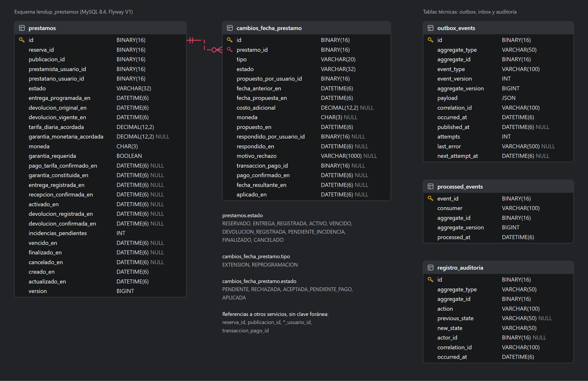
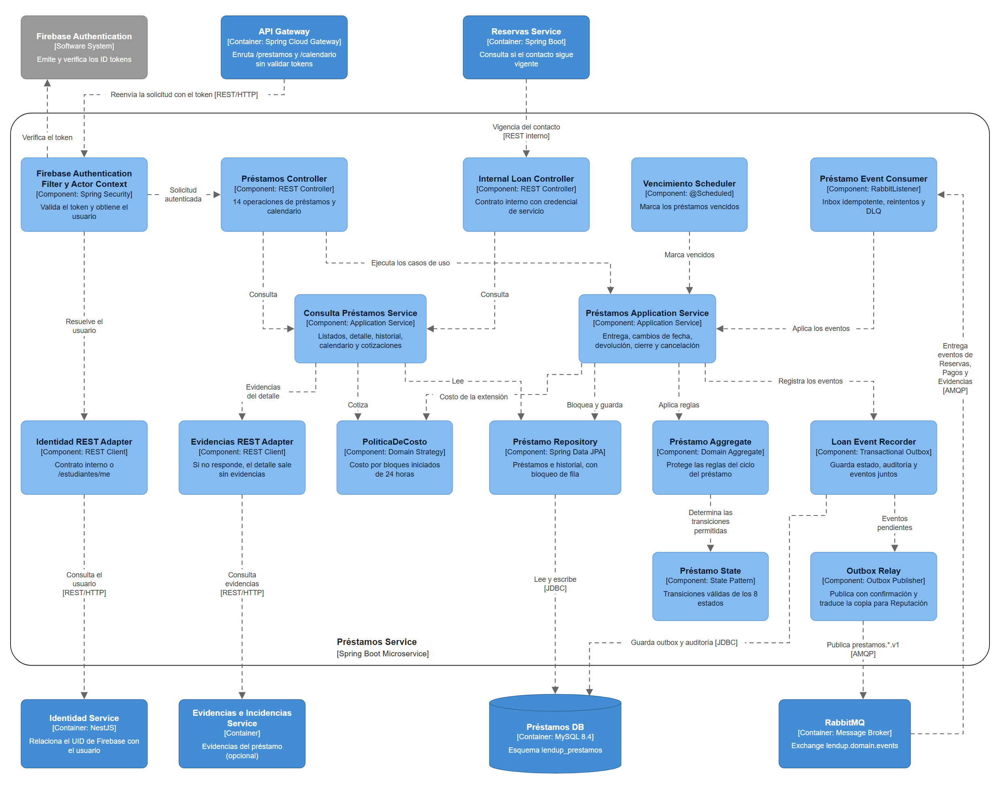

# Arquitectura

## Alcance

Préstamos posee `prestamos`, `cambios_fecha_prestamo`, outbox (`outbox_events`), inbox (`processed_events`) y auditoría (`registro_auditoria`) en su propia base `lendup_prestamos`. Reservas, publicaciones, usuarios y transacciones de pago son referencias externas por UUID: no hay claves foráneas hacia otros servicios ni lecturas de otros esquemas (R13).



## Componentes (Fig. 16)



| Componente del diagrama | Clase |
|---|---|
| Préstamos Controller | `interfaces/rest/LoanController` |
| Préstamos Application Service | `application/service/LoanApplicationService` |
| Consulta Préstamos Service | `application/service/LoanQueryService` |
| Prestamo Aggregate | `domain/model/Prestamo` (con la entidad `CambioFecha`) |
| Prestamo State | `domain/state/PrestamoState` y sus estados |
| PoliticaDeCosto | `domain/model/PoliticaDeCosto` (Strategy) |
| Prestamo Repository | puerto `PrestamoRepository`, adaptador `JpaPrestamoRepositoryAdapter` |
| Loan Event Recorder | `application/service/LoanEventRecorder` + `OutboxJpaAdapter` + `AuditJpaAdapter` |
| Outbox Relay | `infrastructure/messaging/OutboxRelay` + `ReputationEventTranslator` |
| Préstamo Event Consumer | `infrastructure/messaging/LoanEventConsumer` |
| Vencimiento Scheduler | `infrastructure/scheduler/OverdueScheduler` |
| Firebase Authentication Filter y Actor Context | `config/security/FirebaseAuthenticationFilter`, `ActorContext` |
| Internal Loan Controller | `interfaces/rest/InternalLoanController` (contrato que ya esperaba Reservas) |
| Identidad REST Adapter | `infrastructure/client/IdentidadRestAdapter` |
| Evidencias REST Adapter | `infrastructure/client/EvidenciasRestAdapter` (evidencias opcionales del detalle) |

`BusinessClock` (hora de Lima) no se dibuja. El flujo completo está en [diagrams/actividades.png](diagrams/actividades.png).

Capas: `domain` (agregado, estados, reglas, sin dependencias de Spring), `application` (casos de uso y puertos), `infrastructure` (JPA/MySQL, RabbitMQ, REST, scheduler) e `interfaces/rest` (DTOs y errores).

## Estados (patrón State)

```
                       cancelar
RESERVADO ───────────────────────────────▶ CANCELADO
   │ registrarEntrega (tarifa pagada y garantía constituida)
   ▼
ENTREGA_REGISTRADA
   │ confirmarRecepcion
   ▼
ACTIVO ──── llega la fecha vigente ─────▶ VENCIDO
   │  ▲                                     │ │
   │  └── extensión pagada (fecha futura) ──┘ │
   │ registrarDevolucion                      │ registrarDevolucion
   ▼                                          ▼
DEVOLUCION_REGISTRADA ◀── resolver todas ── PENDIENTE_INCIDENCIA
   │                 ──── reportar ────────▶
   │ confirmarDevolucion (sin incidencias)
   ▼
FINALIZADO
```

Toda acción está prohibida por defecto; cada estado habilita solo las suyas (`PrestamoStateTest` recorre la tabla completa). Si hay incidencias abiertas al registrar la devolución, se pasa directo a `PENDIENTE_INCIDENCIA`.

## Flujos

1. **Creación:** `ReservaConfirmada` → préstamo `RESERVADO` con copia inmutable de las condiciones (R27) → `PrestamoCreado`.
2. **Entrega y recepción:** `PagoConfirmado` (tarifa) y `GarantiaConstituida` habilitan la entrega (RF19) → `ObjetoEntregado` → recepción → `PrestamoActivado`.
3. **Extensión:** el prestatario la pide (costo por bloques de 24 h) → el prestamista acepta → `ExtensionAceptada` → Pagos cobra → `PagoConfirmado` (extensión) → recién ahí cambia `devolucion_vigente_en` y se publica `FechaDevolucionActualizada`; la original y el historial se conservan. La solicitud y el rechazo también se publican (`ExtensionSolicitada`, `ExtensionRechazada`).
4. **Reprogramación:** la propone el prestamista (`ReprogramacionPropuesta`) y la acepta (`FechaDevolucionActualizada`) o rechaza (`ReprogramacionRechazada`) el prestatario, sin costo.
5. **Vencimiento:** cada `OVERDUE_CHECK_DELAY_MS` se buscan préstamos `ACTIVO` cuya fecha vigente (hora de Lima) ya llegó → `VENCIDO` → `PrestamoVencido`.
6. **Devolución y cierre:** `DevolucionRegistrada` → el prestamista confirma → `PrestamoFinalizado`. Si fue antes del fin del periodo reservado, además `PeriodoPrestamoLiberado` para que Reservas libere los días restantes.
7. **Saga de cancelación:** `CancelacionReservaSolicitada` → si sigue `RESERVADO`, `PrestamoCancelado`; si ya se entregó, `CancelacionRechazada`. Reservas decide con esa respuesta.
8. **Incidencias:** `IncidenciaReportada` e `IncidenciaResuelta` mueven el contador y bloquean o liberan el cierre (RF27).

## Consistencia

- Cada operación bloquea la fila del préstamo (`SELECT … FOR UPDATE`): una entrega y una cancelación simultáneas van en serie y solo una gana.
- Estado, auditoría y outbox se guardan en una sola transacción (RNF21, RNF24).
- **Outbox:** publisher confirms y `mandatory`. Un evento con consumidores conocidos que ninguna cola recibe queda pendiente y se reintenta con espera creciente sin agotarse; los informativos (los que solo generan avisos) se dan por publicados. `ReputationEventTranslator` es la capa anticorrupción que envía a Reputación su copia de `PrestamoFinalizado`. Se respeta el orden por préstamo y se usa `SKIP LOCKED` para varias réplicas.
- **Inbox:** `event_id` en la misma transacción del cambio; 3 reintentos y DLQ `loans.events.v1.dlq`.
- `aggregate_version` es la versión del préstamo: crece en cada cambio, también al rechazar una cancelación, porque Reservas descarta versiones no crecientes.

## Seguridad

Firebase ID token validado en el servicio (revocación y `email_verified`), UID → `usuario_id` por `IdentidadPort` y participación verificada en el agregado: el rol de acceso no basta (R19). `/internal/**` usa una credencial de servicio propia de al menos 32 caracteres, comparada en tiempo constante, y no acepta tokens de Firebase.

## Desvíos respecto al informe

- **`PENDIENTE_INCIDENCIA`** (Fig. 9) existe en el dominio y la base, pero la API lo muestra como `DEVOLUCION_REGISTRADA` porque el frontend y el monolito no lo conocen; el valor real va en `estado_detalle`.
- **`garantia_monetaria_acordada`** se guarda en `prestamos` porque la cotización la leía de `reservas`, que ahora es de otro servicio.
- Los estados y tipos son `VARCHAR` con `CHECK`, no `ENUM`, y los identificadores son `BINARY(16)`.
